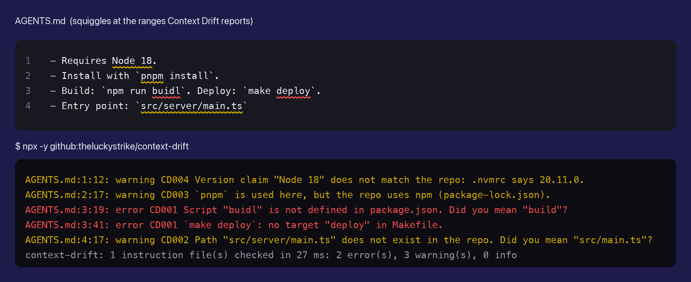

# AGENTS.md & CLAUDE.md Linter (Context Drift)

Context Drift finds the commands, paths and versions in your AGENTS.md, CLAUDE.md, Cursor and Copilot rules that no longer match your repo.



*Drawn from real output on [`test/fixtures/readme-example`](test/fixtures/readme-example). The editor half is a drawing made from the CLI's JSON output. The CLI half is its real text output.*

- Catch renamed scripts, moved files and the wrong package manager before your coding agent trips on them.
- A quick fix replaces a wrong script, path or package manager in one click, and "Apply all" fixes the whole file.
- It runs locally with no network and no account, and the same check runs in CI.

## Quick start

1. Install Context Drift and open a folder that has an `AGENTS.md`, `CLAUDE.md` or other agent instruction file. Findings show up as squiggles and in the Problems panel.
2. Put the cursor on a finding and press `Ctrl+.` (`Cmd+.` on macOS) to fix it.

For a short tour, run "Context Drift: Get Started" from the Command Palette.

## Why

Agent instruction files state facts about your repo, like which commands to run, where files live, and which package manager and runtime to use. Code moves on and these files don't. Then the agent runs a script that no longer exists, opens a file that moved, or installs with the wrong package manager.

Context Drift compares what your instruction files say with what is actually in the repo. It shows each mismatch in the editor, with the exact range and a quick fix where one is cheap.

It reads `AGENTS.md`, `CLAUDE.md`, `CLAUDE.local.md`, `GEMINI.md`, `.cursorrules`, `.cursor/rules/**/*.mdc`, `.github/copilot-instructions.md`, `.github/instructions/**/*.instructions.md`, `.windsurfrules`, `.windsurf/rules/**/*.md`, `.clinerules` (file or folder), and `SKILL.md`.

It's built for precision over recall. It skips text that reads as negated, historical, hypothetical or an example, and paths it can't check, so it misses some real drift. On the repositories we measured, about 9 in 10 reported findings were true (see [Precision](#precision)). We haven't measured recall on real files.

## Before / after

`AGENTS.md` in a repo that moved from pnpm to npm, renamed its deploy target, moved `main.ts`, and upgraded Node. Below is the real output on [`test/fixtures/readme-example`](test/fixtures/readme-example).

```markdown
- Requires Node 18.
- Install with `pnpm install`.
- Build: `npm run buidl`. Deploy: `make deploy`.
- Entry point: `src/server/main.ts`
```

```text
$ npx -y github:theluckystrike/context-drift
AGENTS.md:1:12: warning CD004 Version claim "Node 18" does not match the repo: .nvmrc says 20.11.0.
AGENTS.md:2:17: warning CD003 `pnpm` is used here, but the repo uses npm (package-lock.json).
AGENTS.md:3:19: error CD001 Script "buidl" is not defined in package.json. Did you mean "build"?
AGENTS.md:3:41: error CD001 `make deploy`: no target "deploy" in Makefile.
AGENTS.md:4:17: warning CD002 Path "src/server/main.ts" does not exist in the repo. Did you mean "src/main.ts"?
context-drift: 1 instruction file(s) checked in 9 ms: 2 error(s), 3 warning(s), 0 info
```

Here's the file after the quick fixes (and picking `deploy-prod` from the Makefile).

```markdown
- Requires Node 20.
- Install with `npm install`.
- Build: `npm run build`. Deploy: `make deploy-prod`.
- Entry point: `src/main.ts`
```

## What it checks

Each finding has a stable rule id, a severity, and an exact range.

### CD001 command drift
It's an error for `npm run X`, `pnpm run X` and `make X` checked against the manifest in the right folder. Every other form is a warning (`npm test`, bare `pnpm X` / `yarn X` / `bun run X`, workspace-wide `--filter`/`-r`, `just`, `task`, `cargo`, `uv run`, a Makefile found only in a parent folder).

#### Commands it checks

- `npm run X`, `npm test`, `npm start`, `pnpm X`, `yarn X` and `bun run X` where `X` isn't in `scripts`. It checks the nearest `package.json` and the root one. With `--filter`, `-r`, `-w` or `--workspace` it checks every workspace package. If the script exists in another workspace package, or in a `package.json` above the opened folder (up to the git root), it reports nothing. Binaries from dependencies count (`yarn vue-cli-service` from `@vue/cli-service`).
- `make X` with no target `X` in the Makefile, including `include`d files, `-C dir` and `-f file`. Makefiles that generate targets (`$(eval ...)`, pattern rules) and targets defined in a Makefile further down the tree aren't reported.
- `just X` with no recipe or alias `X`, and `task X` with no task `X` in the Taskfile.
- `cargo -p crate` and `cargo --bin name` for crates and binaries that don't exist. `cargo X` when the repo defines `[alias]` but not `X`.
- `uv run X` and `poetry run X` when `X` isn't in `[project.scripts]` or `[tool.poetry.scripts]` and isn't a declared dependency.

#### How it reads commands

- It understands `cd dir && …`, environment prefixes (`FOO=1 …`), and `$ ` prompts. In `console` blocks, and in shell blocks that use `$ ` prompts, only prompt lines are commands; the rest is output. `make test    Run the tests` listings stop at the description.
- It doesn't flag built-ins (`npm install`, `pnpm add`, `bun test`, `cargo build`, …) or placeholders (`npm run <script>`).

#### Negated and historical text

It skips negated or historical text. The words *no, not, never, don't, avoid, instead of, deprecated, removed, old* (and similar) in the clause before the command, or on the previous line of the same paragraph, turn the check off, as in "There is no root `pnpm dev`" or "don't run `npm run eject`". A new clause starts in four places.

- After *until, unless, before, but, then*. "Do not open a PR until `make check` passes" is checked.
- After a comma, when two or more words follow it, or an imperative such as *run, use, call, regenerate*. "Never edit generated files, run `npm run codegen` instead" is checked. A list ("`a`, `b` or `c`") and an aside after a bare negation ("Do not, under any circumstances, run `X`") stay negated.
- After the comma that ends an opening *instead of, unlike, rather than* phrase. In "Instead of `npm run old`, use `npm run new`" and "Unlike `npm run old`, `npm run full` runs everything" the second command is checked.
- After *and*, when three or more words follow it, or when an imperative follows four or more words. "Do not push to main and run `npm run lint` before merging" is checked, "Never build and run `X`" isn't.

A negation followed by *without, forget, fail to, skip, omit, ignore* is a requirement only when that word governs the command directly: "Never commit without running `npm run lint`", "Don't forget to run `npm run typecheck`" and "Do not skip `npm run typecheck`" are checked. In "Do not skip tests by calling `npm run skip-tests`" the command is the forbidden means, so it stays skipped. Words after the command ("is deprecated", "(removed)", "no longer works") count only when the command is their subject.

These are word rules, not a grammar. Unusual sentences can still be misread, in either direction.

It also skips commands that the text says run somewhere else ("inside its package directory", "from the workspace root", "from the library"). In a sparse checkout it skips workspace-wide forms, because the packages may not be checked out. If the instruction file is a skill (`SKILL.md`), this rule is off, since skills usually describe other projects.

### CD002 path drift
Reported as a warning (globs as info).

- Backticked relative paths (`src/foo.ts`, `./docs/x.md`, `folder/`, `.\scripts\build.ps1`) and markdown links that don't exist.
- Module-style paths without an extension count as present when a file with a usual extension or an `index` file exists (`src/utils/format` → `src/utils/format.ts`, `pages/api/hello`). `./utils` in `packages/x/AGENTS.md` may also mean `packages/x/src/utils`.
- It suggests a fix when exactly one file with the same name exists elsewhere, which is usually a moved file.
- Globs that match nothing (`src/**/*.vue`) are reported as info, including Cursor `.mdc` `globs:` and Copilot `applyTo:` patterns that never apply. A glob whose last part has no extension (`packages/*/src`) also matches folders. At most 200 globs per file are checked.

#### What it ignores

It ignores URLs, `~/` and absolute paths, and paths right after an external URL or an `owner/repo` name (they live in that other repo). It also skips `../` paths that climb above the opened folder (`../shared/config.ts` in a monorepo package opened on its own). They may exist outside it, so they aren't checked. Placeholders (`<name>`, `path/to/`, `my-app`, `your_tool.py`, `mycommand.go`) are skipped too.

Gitignored paths and globs are skipped. Each `.gitignore` in the repo and `.git/info/exclude` are matched against the whole path, wildcards included, and when git is allowed, `git check-ignore` has the last word. `.gitignore` negation (`!folder/`) isn't modeled, so a path under a re-included folder is treated as ignored and not reported.

It skips build output and scratch folders (`dist`, `build`, `out`, `cjs`, `generated`, …), tool state folders such as `.scratchpad/`, paths inside git submodules, code fences, and anything under an "Example" heading.

Text that names, creates, generates or stores a file rather than claiming it exists is skipped too ("a file named `X`", "make sure `X/` exists", "regenerate `X`", "stored in `X`"). Generic words such as *new*, *like* and *into* count only within the 4 words before the path, so "New API handlers go in `src/api/handlers.ts`" is checked.

#### Special folders

- In a sparse checkout, a missing path is reported only when `git ls-files` confirms it isn't in the repo. Without git, missing paths aren't reported there.
- If the folder isn't a git repository root, has no manifest, and most referenced paths are missing, it reports one info "Not a project root" instead of a list of missing paths. That's the usual case for an instruction file copied somewhere else.
- In `SKILL.md` it checks only the skill's own bundle: links and `scripts/`, `references/`, `assets/` and similar paths, resolved against the skill folder and the plugin root.

### CD003 package-manager drift
Reported as a warning.

- The file says `pnpm`, `yarn`, `bun` or `npm`, in a command or in prose ("we use yarn"), but `packageManager` or the lockfile says another.
- The quick fix replaces the command, for example `npm run dev` → `pnpm run dev`.
- Global installs (`npm i -g`) are fine.

### CD004 version drift
Reported as a warning.

"Node 18", "Python 3.11+", "Go 1.22", `nvm use 18` and `pyenv local 3.10` are checked against `.nvmrc` and `.node-version`, `engines.node` and `volta.node`, `.python-version` and `runtime.txt`, `requires-python` and Poetry's `python`, `go.mod` (`go` and `toolchain`), and `.tool-versions`.

- In prose, "Node" must be capitalized (or written `Node.js`, `nodejs`, "node version"), so "node 7 of the cluster" isn't a version claim.
- A package-level instruction file is compared with its nearest `package.json`, not with the workspace root.
- It understands ranges (`>=18 <21`, `^20`, `~=3.11`) and version matrices ("Node 18, 20 and 22").
- Historical, feature and CI text is ignored: "dropped Python 3.8", "added in Go 1.23", "Node 18 is too old", "CI runs Python 3.14".

### CD005 cross-file conflict
Reported as info.

- `AGENTS.md` says `make test` and `CLAUDE.md` says `npm test`.
- Two instruction files in the same scope give different commands for the same verb: test, build, lint, format, dev or typecheck.
- Files in subfolders are a separate scope, and commands that run in different folders (`npm test` vs `cd api && pytest`) don't conflict.

### CD006 stale file
Reported as info, and off by default.

- Turn it on with `--stale` (CLI) or `contextDrift.gitStaleness` (editor).
- The instruction file's last commit is older than 180 days, and the repo has 50 or more commits since then.
- It uses `git log`, read-only, with a 3 s timeout per call. It's skipped silently when there's no git and in untrusted workspaces.

### Suppressing a finding

```markdown
<!-- context-drift-disable-next-line CD002 -->
- `generated/schema.ts` appears after `npm run codegen`.

<!-- context-drift-disable-next-line CD001 -->   (above a code fence: the whole block)
```bash
npm run legacy-task
```

<!-- context-drift-disable CD006 -->   (whole file)
```

Directives count only as real HTML comments. Text in a code span that shows the syntax doesn't turn anything off. In YAML frontmatter (Cursor `.mdc`), use a YAML comment such as `# context-drift-disable-next-line CD002`. The quick fix picks the right form.

## Format linting is agnix's job

Context Drift doesn't lint the *format* of instruction files (frontmatter, rule schemas, hook and MCP config, and so on). Use [agnix](https://github.com/agent-sh/agnix) for that. It has hundreds of lint rules for Claude Code, Codex, Cursor, Copilot and more. The two tools fit together. agnix checks that the file is well-formed, and Context Drift checks that it's still *true*. Run both.

## Editor

- Diagnostics appear when you open, edit (debounced) or save an instruction file. They also refresh when `package.json`, a Makefile, a lockfile, `.nvmrc` and similar files change, and when files are created or deleted. Saving any other file does nothing.
- The checks and git run in a worker thread, never on the extension host. The repository view is cached. An instruction-file edit reuses it, a manifest change re-reads only the manifests, and only created or deleted files make it walk the folder again. The engine stops after 20 s and returns what it has, and lists the files it didn't check. The worker is stopped when one folder's check runs longer than 30 s, counted from when the worker starts that check. In a multi-root workspace, the other folders' checks that this drops are run again.
- Run the command "Context Drift: Check Workspace" to check everything.
- The status bar shows `Drift: N` (warnings and errors). Click it to re-check.
- Run "Context Drift: Get Started" to open the walkthrough.

Quick fixes can replace a script, target or path with the suggestion, or replace the package manager. When a file has two or more of these fixes, "Apply all N Context Drift fixes in this file" applies them in one edit. It shows only while the file is unchanged since the last check, so it never applies a fix at an old position. After you type, it comes back when the re-check finishes (about half a second). It leaves out a fix that overlaps another one. They can also show scripts in `package.json`, open the Makefile, or reveal the referenced file's folder. And they can disable a check for this line (or code block) or ignore a rule in this workspace.

### Settings

| Setting | Default | Description |
| --- | --- | --- |
| `contextDrift.enable` | `true` | Turn the checks on or off. |
| `contextDrift.ignoreRules` | `[]` | Rule ids to skip, for example `["CD005", "CD006"]`. |
| `contextDrift.useGit` | `true` | Use read-only `git check-ignore` and `git ls-files` to skip ignored paths and files a sparse checkout leaves out. 3 s timeout per call. Always off in untrusted workspaces. |
| `contextDrift.gitStaleness` | `false` | Turn on CD006 (`git log`, read-only). Always off in untrusted workspaces. |
| `contextDrift.staleDays` | `180` | CD006 age threshold, in days. |
| `contextDrift.staleCommits` | `50` | CD006 commit threshold. |
| `contextDrift.askForRating` | `true` | Ask one time for a Marketplace rating, after 5 checks and 2 days. Turn it off with `false` |

## CLI

The CLI isn't published to the npm registry. Run it from GitHub with `npx`, or from a clone.

```bash
npx -y github:theluckystrike/context-drift                    # check the current repo
npx -y github:theluckystrike/context-drift path/to/repo       # or a repo / a single instruction file
npx -y github:theluckystrike/context-drift --json             # machine-readable
npx -y github:theluckystrike/context-drift --format github    # GitHub Actions annotations
npx -y github:theluckystrike/context-drift --fail-on warning --ignore CD005

# or: git clone https://github.com/theluckystrike/context-drift && node context-drift/bin/context-drift.js .
```

Don't run `npx context-drift` without the `github:` prefix. There's no npm package by that name, and someone else could publish one.

The options are `--json`, `--format text|json|github`, `--fail-on error|warning|info|never`, `--ignore <ids>`, `--stale` (turn on CD006), `--no-git` (never run git), `--stale-days`, `--stale-commits`, and `-q`. Files that aren't checked (over 1 MB, a symlink that leaves the folder, lines over 4,000 characters) are listed on stderr.

The exit code is `0` when there are no findings at the `--fail-on` level (default `error`), `1` when there are findings at that level, and `2` on a usage error.

### GitHub Action

Pin a tag, so a later change in the repo can't change your CI.

```yaml
name: context-drift
on:
  pull_request:
    paths: ["**/*.md", "**/.cursorrules", "**/*.mdc", "package.json", "Makefile", "justfile", "pyproject.toml", "go.mod", ".nvmrc"]
concurrency: { group: context-drift-${{ github.ref }}, cancel-in-progress: true }
jobs:
  drift:
    runs-on: ubuntu-latest
    timeout-minutes: 5
    steps:
      - uses: actions/checkout@v4
      - uses: actions/setup-node@v4
        with: { node-version: 20 }
      - run: npx -y github:theluckystrike/context-drift#v0.1.3 --format github
```

`--format github` prints `::error`, `::warning` and `::notice` workflow commands, so findings show up inline on the PR diff. Add `--stale` and `fetch-depth: 0` on the checkout step if you want CD006.

## Speed and safety

It has zero runtime dependencies. One small CommonJS engine is shared by the extension and the CLI. A 5,000-file repo takes about 20 ms on an M-series Mac. It never reads `node_modules`, `.git`, `dist`, `build`, `vendor`, `target` or `.venv`, and it skips nested git repos and worktrees.

### Hostile repos

Globs from the repo are never turned into regular expressions. A linear-time matcher handles them instead, and every line regex is linear. Inputs are capped at 1 MB per file, 4,000 characters per line, 200 globs, 20,000 code spans, 2,000 findings per file and 32 targets per `make` command. Work stops at the finding cap, and a run stops after 20 s.

Tests time the adversarial inputs from both independent reviews at about 1 MB. The first review's must take under 250 ms of CPU each (they take 1–50 ms, and the quadratic versions took 5 s and more). The second review's must take under 300 ms (the slowest takes about 70 ms on an M-series Mac). Other inputs can be slower, and the 20 s budget bounds them.

- Text output (`--format text`) and diagnostic messages escape control and bidi characters from the repo as `\uXXXX`. In text output, line breaks and tabs in file names and messages are escaped too, so each finding is exactly one line. `--format github` percent-encodes line breaks, `%`, `,` and `:`. So a hostile file name or path can't rewrite your terminal or print its own line (such as a forged `::error` command) into a CI log.
- git runs only asynchronously, read-only, with `--no-optional-locks`, `core.fsmonitor=false` and a 3 s timeout per call. A hung git is killed.
- Binary, huge, CRLF, BOM, Unicode and broken (`package.json` with comments) files never crash it.

## Precision

Measured for 0.1.1 on the same material as the independent review of 0.1.0 (details in `NOTES.md` in the repository). 0.1.2 gives exactly the same warnings and errors on the 184 local folders below (re-run on 2026-11-05: none added, none removed). We compared 0.1.3 with 0.1.2 on the same 184 folders (2026-11-05) and got the same 264 findings, none added, none removed.

- Real source repositories from the review (a webdriverio checkout, promptbook, a small CLI repo): 4 findings, all true. 0.1.0 reported 4 true and 14 false findings there.
- 184 local folders with 3,629 instruction files (git off, as in the review). Overall, about 1 finding in 10 is false. CD001 gave 6 findings, 1 false (0.1.0 gave 31 findings, 26 false). CD004 gave 3 findings, none false (0.1.0 gave 8, 5 false). CD005 gave none (0.1.0 gave 4, all false). CD002 gave 224 warnings (0.1.0 gave 921). In a random sample of 40, 4 were false. Another 21 are technically true, but they sit in folders that hold a copy of an instruction file without the source.
- All 48 adversarial cases from the review pass (0.1.0: 24 false positives, 1 false negative).
- Of the 53 cases of the second review (0.1.1), 50 pass (0.1.1 passed 42). Of its 17 recall cases, 0.1.2 reports the expected finding in all 17 (0.1.1: 10). The three cases that don't match are known. They're `.gitignore` negation (not modeled), a span with terminal control characters (not read as a command), and one case where the review's own expectation was wrong ("Go 1.20 or newer" against `go 1.22` is true drift and is reported). These cases are regression tests in `test/review-r2.test.js`.
- Of the 51 cases of the third review (0.1.2), 0.1.3 passes 42 (0.1.2 passed 34). The 9 that don't match are known false negatives, and none of them is a false finding. `npm run foo`/`bar` are placeholders and never checked (the same sentence with real names passes). *add, write, may* anywhere in a sentence still hide a path (3 cases, precision first). Include/import cycles in Makefile, justfile and Taskfile (3 cases) and `"scripts": null` report nothing, and a `make` target with control characters isn't read as a target. These cases are regression tests in `test/review-r3.test.js`.

## Privacy

Context Drift runs locally. It makes no network requests and has no telemetry. It reads files inside your workspace only, and a symlinked instruction file or manifest that points outside the workspace is skipped. In trusted workspaces it may run read-only git (`check-ignore`, `ls-files`, and `log` when CD006 is on). Nothing leaves your machine.

## License

MIT © 2026 Zovo

## More viewers by Zovo

- [PDF Viewer & Reader with Dark Mode](https://marketplace.visualstudio.com/items?itemName=zovo.pdf-viewer-dark) reads PDFs with a dark mode, search, an outline and thumbnails.
- [CSV, Excel & Parquet Viewer](https://marketplace.visualstudio.com/items?itemName=zovo.table-viewer-vscode) opens Parquet, Excel and CSV files as a sortable, filterable table.
- [DOCX Viewer & Word Viewer](https://marketplace.visualstudio.com/items?itemName=zovo.docx-viewer-vscode) previews Word files with dark mode, an outline and search.
- [HDF5 & NetCDF Explorer](https://marketplace.visualstudio.com/items?itemName=zovo.hdf5-netcdf-explorer) browses groups, variables and attributes in scientific data files.
- [PPTX Viewer for PowerPoint](https://marketplace.visualstudio.com/items?itemName=zovo.pptx-slide-viewer) shows PowerPoint slides, thumbnails and speaker notes.
- [Skill Shelf](https://marketplace.visualstudio.com/items?itemName=zovo.skill-shelf) lists, checks and toggles the Agent Skills that Claude Code, Codex and Cursor load.
- [Tensor Viewer](https://marketplace.visualstudio.com/items?itemName=zovo.tensor-viewer) shows NPY, NPZ, Safetensors and GGUF tensors with stats and heatmaps.
